# Norway Real Estate Price Estimator

[](https://github.com/MaxxxZu/norway-real-estate-price-estimator/actions/workflows/ci.yml)
[](https://github.com/MaxxxZu/norway-real-estate-price-estimator/actions/workflows/docker-build.yml)
[](https://www.python.org/downloads/)

A Python backend and applied ML project for estimating Norwegian property prices
from transaction data. It combines a FastAPI inference service, CatBoost training,
Celery orchestration and an S3-compatible artifact registry.

The engineering focus is on reproducible data, shared training/serving features,
temporal evaluation and traceable model selection.

## Project status

This is a production-oriented portfolio project under active development.
It is not presented as a production-ready valuation service or independently
validated source of current market prices.

| Area | Current implementation and evidence |
| --- | --- |
| Backend | FastAPI contracts, validation, health/readiness and model-version responses; offline tests |
| Data | Normalized rows, immutable snapshot revisions, semantic fingerprints and source lineage; in-memory storage tests |
| Features | Shared versioned transformer and a persisted reference year; training/inference parity tests |
| Evaluation | Explicit temporal train/validation/test, validation-only early stopping, train-only baseline and paired comparison; synthetic spy-model tests |
| Background processing | Explicit task registration and Redis backend validation; one real RabbitMQ/Redis chord smoke with a separate solo worker |
| Infrastructure | Docker, Compose, Helm and GKE workflow files are included; current cluster/provider deployment is not verified by the tests above |

Synthetic tests verify contracts and orchestration, not real-world model accuracy.
The historical model report at the end uses an older evaluation protocol.
No new real-data accuracy results are claimed for the temporal implementation.

## Architecture

```mermaid
flowchart LR
    SOURCE[External transaction API] --> FETCH[Monthly ingestion]
    CRON[Optional CronJob trigger] --> CELERY[Celery chord: RabbitMQ + Redis]
    CELERY --> FETCH
    FETCH --> RAW[Versioned source snapshots]
    RAW --> MERGE[Merge and deduplicate]
    MERGE --> DATA[Normalized dataset + manifest]
    DATA --> SPLIT[Temporal train / validation / test]
    SPLIT --> TRAIN[CatBoost: train + validation]
    TRAIN --> EVAL[Common holdout evaluation]
    SPLIT --> EVAL
    CURRENT[Champion artifacts + exposure lineage] --> EVAL
    EVAL --> GATE[Promotion gate]
    GATE -->|accepted| REGISTRY[S3-compatible model registry]
    REGISTRY --> CACHE[ModelRegistry + predictor]
    CACHE --> API[FastAPI inference]
```



Snapshots have immutable revision paths. The model registry stores versioned
artifacts and a mutable `latest.json` pointer; storage-enforced model immutability
and concurrency-safe promotion are not established yet.

## Components

- **Ingestion:** fetch transactions, resolve property features and normalize rows.
- **Datasets:** retain source rows, write normalized Parquet and completion
  manifests, and track exact source revisions and semantic fingerprints.
- **Training:** CatBoostRegressor on `log1p(price)` with `expm1` for predictions.
  Shared features include location, property type, areas, building attributes,
  area ratio and building age relative to the model's stored reference year.
- **Evaluation:** calendar splits with property-overlap checks; MAE, RMSE, MAPE,
  MdAPE, WAPE and AE_p90 overall and by property type. A train-only segment-median
  baseline uses a global fallback for unseen segments.
- **Comparison:** champion and challenger evaluate identical holdout rows using
  their own saved feature schemas. Unknown or inconsistent exposure metadata
  blocks comparison and automatic promotion.
- **Serving:** FastAPI loads the active learned model from trusted object storage.
  Current artifacts use joblib; only trusted publishers may write model artifacts.
- **Observability:** structured application logs, request IDs and an HTTP
  Prometheus metrics endpoint. Worker metric collection and broader failure
  instrumentation still require additional work.

Detailed contracts:

- [Datasets, features and snapshot revisions](docs/DATA_CONTRACTS.md)
- [Temporal evaluation and model comparison](docs/TEMPORAL_EVALUATION.md)
- [Tests, isolation and integration evidence](docs/TESTING.md)

## API

| Endpoint | Purpose |
| --- | --- |
| `GET /health` | Process liveness |
| `GET /ready` | Availability of a loadable active model |
| `POST /estimate` | Property-ID-to-features batch request; NOK estimates and model version |
| `GET /metrics` | Model metrics read from the registry |
| `GET /metrics/summary` | Formatted model-quality summary |
| `GET /metrics/prometheus` | Prometheus text exposition for HTTP metrics |

Pydantic validates required features and cross-field constraints, including
`total_area >= bra` and an explicit floor for apartments. Schema validation errors
return 422. A missing or unsupported active model produces 503 through the
readiness/predictor dependency. Unhandled artifact failures are not yet a fully
hardened public error contract.

Prediction currently iterates over the batch. Authentication, rate/body/batch
limits and stricter production CORS settings are not supplied as a complete
public-access boundary. Keep the service local or behind an independently
configured access boundary; no public hosted demo is claimed here.

## Local development

Python 3.11 is the tested development version. Install `uv` separately.
The following commands install dependencies and start only the API process;
they do not fetch data, train a model or initialize the registry.

```sh
uv sync --locked
cp .env.example .env
uv run --locked --no-sync uvicorn app.main:app --host 127.0.0.1 --port 8000
```

Review the copied environment before use. Its local demo credentials are not
suitable for an exposed deployment. The configured S3-compatible service must be
reachable for model-dependent requests. For host-run processes, use reachable
host endpoints rather than container-only service names.

- [Swagger UI](http://localhost:8000/docs)
- [ReDoc](http://localhost:8000/redoc)
- [Health](http://localhost:8000/health)

Before an active compatible model is available, `/ready` and `/estimate` are not
expected to return successful predictions. `/health` is independent of model
availability. Obtaining real data requires separate authorized access to the
external API; it is not a prerequisite for the default offline tests.

```sh
uv run --locked --no-sync pytest
```

The default suite uses synthetic configuration and blocks network connections and
CatBoost fitting in the pytest process. Integration and fitting tests need
explicit opt-in flags; see [Testing](docs/TESTING.md). These Python guards are not
an operating-system sandbox for arbitrary subprocesses.

## Training and model lifecycle

Both synchronous and Celery training require four explicit calendar settings:
`REE_SPLIT_TRAIN_START`, `REE_SPLIT_VALIDATION_START`, `REE_SPLIT_TEST_START` and
`REE_SPLIT_TEST_END`. No implicit production dates or random fallback are used.
Rows outside the selected window and forbidden cross-partition property overlap
cause preflight failure. See the temporal contract for exact interval semantics.

Rolling jobs reuse monthly source revisions, build a rolling dataset and pass
explicit boundaries to training. RabbitMQ and Redis are required for the chord.
A queued task ID confirms submission, not successful training or promotion.

Automatic promotion requires a complete explicit promotion policy and valid
candidate evidence. With a champion, paired evaluation and lineage must agree;
bootstrap is disabled unless explicitly requested and the active pointer is
confirmed absent. No production thresholds are supplied. See the
[policy contract](docs/TEMPORAL_EVALUATION.md#promotion-policy). Retry-safe
publication and concurrent pointer updates are not established. Training and
artifact creation do not establish safe production activation.

Unversioned snapshots and learned models without the supported feature schema are
not silently migrated. Plan data rebuilding, retraining and activation separately;
see the documented compatibility contracts before changing serving code.

## Infrastructure and deployment boundary

- `docker-compose.yml` describes RabbitMQ, Redis, MinIO and Prometheus services.
- `deploy/Dockerfile` and `deploy/helm` contain container/cluster configurations.
- The release workflow describes GHCR image publication and GKE deployment.
- Supplied training schedule values are suspended by default.

These files are reference configurations, not a currently verified turnkey
installation recipe. Helm rendering/dependencies, reproducible image builds,
worker readiness and cloud storage compatibility require their own checks.
The GKE configuration targets GCS S3 interoperability; that target is not evidence
that all storage operations or concurrency semantics match MinIO or AWS S3.
The release badge links to workflow history, not a production-readiness guarantee.

## Data, artifacts and licensing

The source API requires separately configured access. This repository does not
provide its credentials or a redistributable real-data training bundle. Historical
features may reflect property state observed after a transaction; frozen snapshots
alone do not establish point-in-time correctness.

A code license has not yet been declared. Permission to redistribute source data
or derived models is not established by access to the API or by this repository.
Do not add real snapshots, model files, exports or private service details without
checking their provenance and publication rights. Example/fixture provenance is
not a substitute for a data license.

## Historical evaluation archive

<details>
<summary>Earlier model results — superseded evaluation protocol, not current accuracy evidence</summary>

The report below is retained as historical context. Its source evaluation
artifacts are not included as a reproducible public bundle. It used a random
split and test-driven early stopping; the figures must not be presented as
independent temporal test performance. Segment labels and thresholds are the
report's descriptive heuristics, not calibrated reliability guarantees.


## 🧠 Model Overview

- **Model type:** `CatBoostRegressor` (CatBoost)
- **Version:** `20260125-2029-9ca500b`

### Target transformation
- **Target:** `log1p`
- **Prediction inverse transform:** `expm1`

---

## 📦 Dataset

**Historical results below:** these counts and quality numbers use the former
random split with test-driven early stopping. They are not evidence for the current
temporal protocol or independent final quality claims. A promotion holdout is used
for model selection; independent claims need a separate subsequent evaluation.
Snapshots do not establish historical availability of external features.

| Split | Records |
|------|---------|
| Train | 19,157 |
| Test  | 4,790  |

---

## 📈 Overall Performance (Historical Evaluation Set)

| Metric | Value |
|------|------|
| MdAPE | **11.64 %** |
| WAPE | 17.14 % |
| MAE | 800 166 NOK |
| RMSE | 1 428 602 NOK |
| AE P90 | 1 835 471 NOK |

---

## 🏘️ Performance by Real Estate Type

| Segment | Status | MdAPE (%) | WAPE (%) | AE P90 (NOK) |
|-------|--------|-----------|----------|--------------|
| **Leilighet** | ✅ Good | **8.97 %** | 13.83 % | 1 543 767 |
| **Rekkehus** | ✅ Good | 10.35 % | 14.48 % | 1 489 330 |
| **Tomannsbolig** | ⚠️ OK | 13.23 % | 17.06 % | 1 662 487 |
| **Enebolig** | ⚠️ OK | 17.98 % | 23.28 % | 2 561 397 |
| **Hytte** | 🚨 Risk | **24.95 %** | 32.14 % | 1 953 981 |

---

## 🥇 Best & Worst Segments

- **Best segment:** `leilighet` — MdAPE **8.97%**
- **Worst segment:** `hytte` — MdAPE **24.95%**

---

## 🎯 Quality Thresholds

| Threshold | Value |
|---------|-------|
| **MdAPE (Good)** | ≤ 12% |
| **MdAPE (OK)** | ≤ 18% |
| **AE P90 Tail Risk** | ≥ 2,000,000 NOK |

---

## 📝 Notes

- Worst segment is **`hytte`** (MdAPE 24.95%)
- Likely causes:
  - High price heterogeneity
  - Sparse or noisy data

---

## ⏱️ Metadata

- **Generated at:** `2026-01-25T20:31:53Z`

</details>
